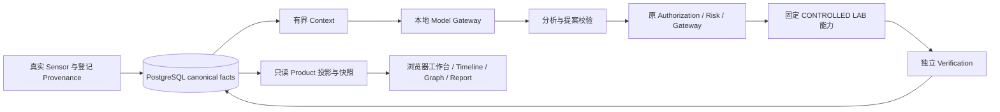

# v1.0 架构与数据边界

No ai.5 architecture change required。版本增加安装/升级/恢复、操作员协调、日志脱敏与交付治理，不新增SOC/Event Intelligence/Verification引擎。Linux-native Control Plane + Browser Web Console，原项目Logo与定稿React视觉保留；不引入Electron/Tauri。

Proposal != Authorization，execution success != security success。独立三维Verification以观测为依据，Sensor不足=>INCONCLUSIVE；模型失败保留确定性基线，高风险自主执行0。AI默认OFF/启用SHADOW，OPTION B/G0边界见 [最终主张](AI_VALUE_FINAL_POSITION_v1.0.md)。

Web API不挂Docker socket，不接受用户命令/目标/外部能力；Browser会话只有product:read/demo:run。宿主机可信Worker根据登记的A–E和profile固定配置执行，Lab/运行ID/租约/清理均检查归属。每运行独立source_environment_id，原历史状态/审计不覆盖。HTTP GET物化只写可丢弃内存缓存，不写canonical表。

Reference API/PostgreSQL在internal control网络；固定标准库ingress无凭据挂载，仅转发API:8000和canonical-postgres:5432到宿主回环，禁止IPforward，cap_drop ALL/只读。Sensor与模型仅内部网络；Suricata为本轮Lab target命名空间采集使用必要NET_RAW/NET_ADMIN/SYS_NICE权限，不能据此授权宿主攻击。具体端口及例外见 [安全基线](SECURITY_BASELINE_v1.0.md)。

核心schema冻结至0016。产品meta schema zhiyu_product独立保存DemoRun/steps，不能替代核心Action/Verification。完整升级与备份保留74表计数/摘要、FK和审计链；新空restore单事务，保留旧用户/密钥/Scope，新DB凭据与网络隔离。

冻结身份见 [RC_STATE](../artifacts/RC_STATE_v1.0.0.json)；原始产品投影细节见 [Dashboard Architecture](DASHBOARD_ARCHITECTURE.md)，当前接口见 [API Contract](API_CONTRACT_v1.0.md)。0.9.0 projection/report版本为冻结协议身份，不是当前运行应用版本。
