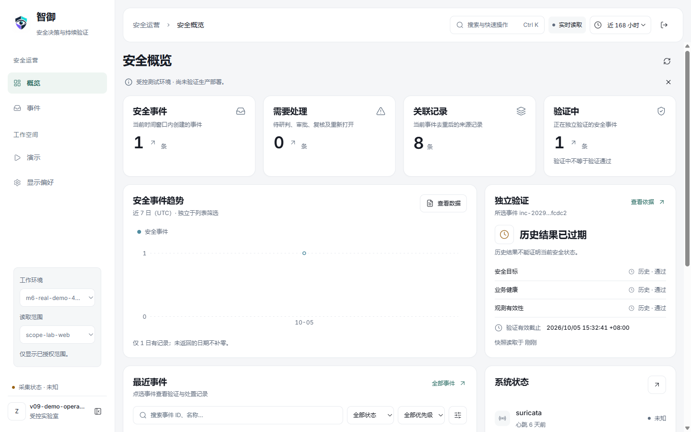
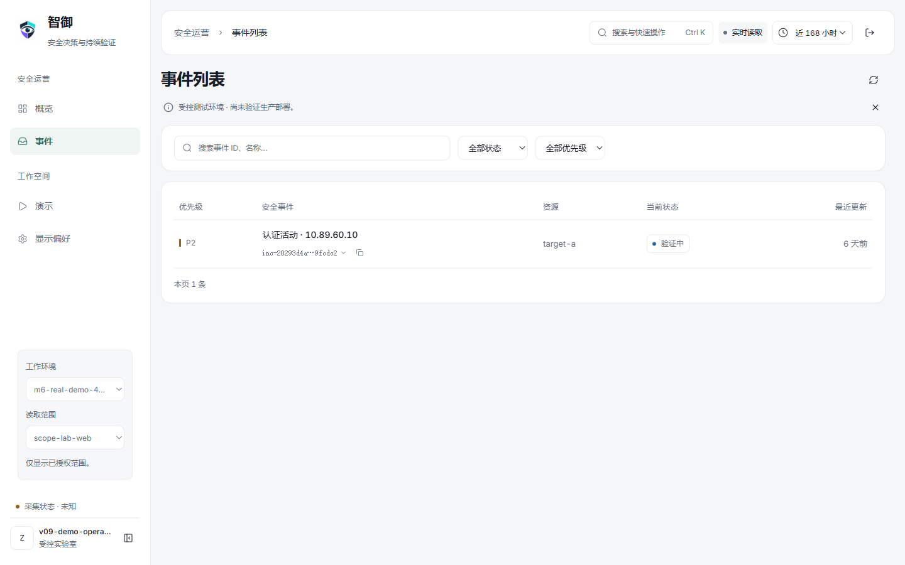
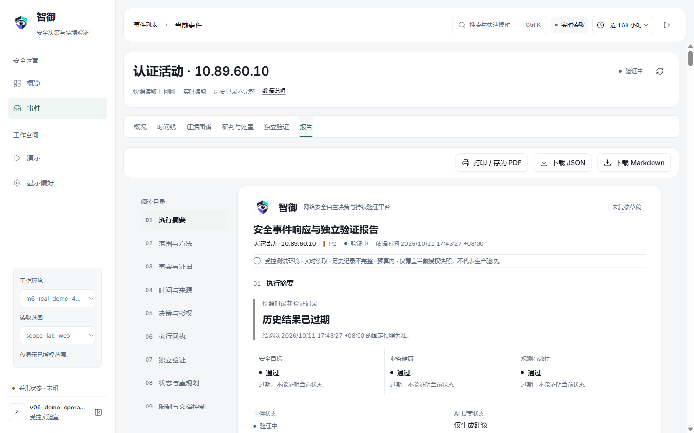

# 当前前端：Sentinel（2026-10-11）

当前源码与 `frontend/dist` 包含已经部署的 Sentinel 界面及精简调整。后端版本保持 v1.0.0。旧版手册截图和冻结清单只对应其注明的历史版本。

- 概览、事件列表、事件详情、时间线、证据图谱与报告使用统一工作框架。
- 未选择事件时显示完整列表，选择后展开详情；手机使用详情抽屉。
- 删除重复标题、无效分页和无条件重置操作，保留来源、授权范围、过期验证等必要说明。
- 正式本地部署检查通过：14 项浏览器检查、13 次成功产品接口读取、15 个静态文件的内容哈希一致；容器内 379 个后端文件保持原哈希。
- 上一轮源码检查通过：ESLint、TypeScript、6 个测试文件中的 32 项测试及构建。部署检查没有重新验收 PDF 分页或生产环境。

以上为 2026-10-11 本地受控实验室真实页面。截图中的历史验证已过期，不能作为当前安全状态的保证。七日窗口只有少量历史记录，没有补造趋势或事件。

生产构建仍存在依赖 `use client` 指令及单块超过 500 kB 的构建警告。安装、开发、账号管理等流程见相应指南。
