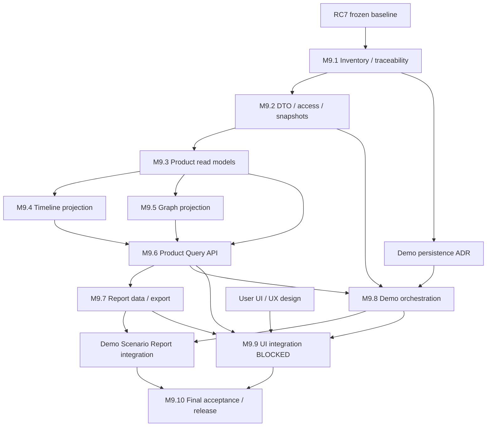

# v0.9.0 — Competition-ready Demo Implementation Plan

> 本文保留 2026-09-28 Inspect + Plan 历史快照。当前 v0.9.0 已完成并 PASS / CONTROLLED LAB；实现与测试结果以 [最终报告](VALIDATION_REPORT_v0.9.0.md) 为准。下文 PLANNED/BLOCKED/未实现描述仅对应编写当时。

**状态：v0.9.0 PLANNED。阶段：Inspect + Plan；未进入 Implement。**

**UI IMPLEMENTATION = BLOCKED BY DESIGN**。

本轮基于 v0.6.0 PASS / CONTROLLED LAB 制定可执行计划，保留 ai.5 Engineering Freeze、原381测试、182项Docker验收历史、A01–A15 15/15 PASS、高风险自动执行0、AI default OFF / enabled default SHADOW。本轮没有开发产品功能、创建前端、修改 API、创建 migration、启动场景或重跑 v0.9 测试。

五类目标固定为 **Dashboard、Timeline、Attack / State Graph、Report、完整演示脚本**。本计划只确定工程数据与依赖，不替负责人决定页面结构、视觉和交互，不选择最终前端框架或组件库。

## 1. 文档导航与检查基线

| 文档 | 责任 |
|---|---|
| [Requirements Traceability](V0.9_REQUIREMENTS_TRACEABILITY.md) | 五类目标逐项映射、源码/表 inventory、18类 timeline 事件来源与缺口 |
| [API Gap Analysis](V0.9_API_GAP_ANALYSIS.md) | 全部现有 API、拟增只读接口、读权限、分页/快照/性能、安全边界 |
| [Graph Data Model Plan](V0.9_GRAPH_DATA_MODEL_PLAN.md) | 节点、边、来源、UNKNOWN、时间语义；不包含 Graph UI |
| [Demo Scenario Plan](V0.9_DEMO_SCENARIO_PLAN.md) | A–E 场景与真实证据、编排契约、幂等/恢复、LIVE/REPLAY、reset |
| 本文 | 工作包、依赖、报告数据计划、数据库/性能决策、测试出口和后续顺序 |

实际源码检查：110 个 Python 文件、16,231 行、47 个显式 HTTP 操作、71 张 ORM 表加 Alembic 共72张；head `0016_lab_remediation`。细节见 inventory 附录。关键服务实现、ORM/契约字段、权限、查询及真实运行报告交叉检查；不是把表存在当功能完成。

冻结证据：[RC7](m6-runtime/rc/RC7.json)、[最终 v0.6 报告](VALIDATION_REPORT_v0.6.0.md)、[正式包校验](../../artifacts/PACKAGE_VALIDATION_v0.6.0.json)。当前源码摘要 `f60a06b0db456ac2c7e282c5522241165747ab65592d64f5d06bd871e5c1aa05`；正式ZIP摘要 `3afd802e3bee0945591d3b7f1e02303bafda33a63679e4fe543a4a72609003a5`。

本轮只增加这五份计划文档；v0.6 已封存 ZIP、Manifest、RC、旧报告及历史失败记录不重新打包或改写。上述测试数量引用正式结果，本轮不声称重新跑过。

## 2. Inspect 结论

### Existing Capabilities / Reusable Components

已有真实双源 ingest、分组/关联/Incident、版本化资源绑定、Evidence/环境状态、Context/ModelRun/Analysis/Proposal/Decision、确定性 TaskGraph、Authorization/Risk/Gateway、lease/fencing、UNKNOWN reconcile、Lab TTL/补偿、三维独立 Verification、bounded Re-plan、Audit/Outbox、部分 metrics 与 Lab reset。

复用边界是原核心服务，不是复制其逻辑。v0.9 不重写 Event Intelligence、Correlation、Incident Engine、Environment State、AI Brain、TaskGraph、Authorization/Risk、Gateway、Verification、Re-plan、Sensor Runtime。没有发现必须更改 ai.5 契约的阻断。

### Missing Product-layer Capabilities / Data Projection Gaps

- 现有接口按内部功能组织，缺统一产品读 DTO、范围一致的 summary/detail、完整 timeline、证据关系 graph、运行健康和可复现报告。
- Incident Timeline API 已存在，但按 ResponsePlan 聚合，缺 Event/AI/授权/State/HumanReview 的完整异构投影；不从零重建核心时序。
- Scope 执行权限已有，但当前 ServicePrincipal 没有 viewer 的 scope grants；这是产品读权限的真实缺口。不能默认 UI 可读任意同环境对象。
- `StateRelation` 有契约/表，未发现产品运行链写入者。资源图可以展示事实引用，不能宣称已有攻击因果图。
- 当前全列输出、无界子集合以及全环境 Python metrics 聚合需要产品层白名单和有界 SQL；不把已有 API 直接暴露为比赛后台。
- 当前 SensorHealth/Resource 不是完整时态历史。Audit/Outbox 并非任意旧版本数据的事件存储；历史缺口保持 PARTIAL/UNKNOWN。

### API Gaps / Demo Gaps

缺 Resource/State/Sensor 的产品查询、AI decision 聚合、Plan/Action collection、全链 timeline、graph、snapshot/report、演示运行状态和只读 replay。现有 service bearer 也不是浏览器账号方案。

场景组件已测，但现场单场景生命周期、证据绑定、有限故障步骤、重复触发、崩溃恢复、资源清理、模式标记与导出需新增编排层。AI 状态变更提案仍被拒绝；Lab containment 由明确授权的确定性路径完成。脚本幻觉/声称成功反例不能冒充真实模型推理。

## 3. 目标工程边界

拟新增内部模块（以下路径仅为开发定位建议，本轮未创建）：

- `src/zhiyu/product/contracts.py`：版本化、字段白名单 DTO；不是替代 domain/contracts.py。
- `product/access.py`、`product/queries.py`、`product/snapshots.py`：只读访问策略、有界查询和衍生快照。
- `product/overview.py`、`incident.py`、`timeline.py`、`graph.py`、`health.py`、`ai.py`、`verification.py`：纯投影/聚合，安全判定仍读取原引擎结果。
- `api/routes/product.py`：新只读接口；与原写 API 分开注册。
- `reporting/`：Incident/Demo 报告 DTO、manifest、受控导出，不做任意模板执行。
- `demo/` 与受保护本地 operator runner：固定 scenario registry、run/step 状态、核心服务调用和清理。不能提供远程任意 shell 或 Docker socket。
- 新 tests/fixtures 只为投影/查询/演示隔离；旧381测试保留，不改写以迎合产品层。

**技术可提前准备，不等于本轮已授权实施。** M9.2–M9.8 可独立于视觉设计开展，但本轮到计划结束停止；后续收到负责人 UI/UX 设计和实施指令后再进入 Implement。若负责人另行明确授权先做后端，再按这些依赖执行。

## 4. Work Breakdown Structure

每个工作包都采用 LOW/MEDIUM/HIGH 复杂度，不给未经验证的精确工时。下面的 tests 和 acceptance 是未来实施出口，本轮未执行。

### M9.1 — Product Data Inventory 与契约基线

| 字段 | 内容 |
|---|---|
| objective | 固定五类交付与现有源码、事实字段、路由及 runtime evidence 的映射；本轮已完成 Inspect 产物 |
| reusable components | ai.5 Contract/ORM、RC7、v0.6 report、源码、现有47操作与验收 JSON |
| files/modules likely affected | 本轮五份 `docs/V0.9_*.md`；后续如必要只更新计划，不改历史封存 |
| new internal components | 本轮无产品组件；后续 DTO spec 文档 |
| dependencies | v0.6 正式交付及本轮要求 |
| inputs | RC/ZIP摘要、源码/表/权限、五类目标 |
| outputs | requirement IDs、事实字典、API/table inventory、字段与真假边界 |
| security constraints | 不输出 secret、不将 raw logs 全量复制进计划，不启动 Lab |
| tests | 文档链接、源码路径/符号、冻结文件/旧包哈希检查；不跑 v0.9 测试 |
| acceptance criteria | 每一交付有源码依据、缺口、任务、验收；不存在的能力明确标缺失 |
| complexity | LOW（计划维护）；跨模块事实核对须完整 |
| blocked-by | 无技术阻断；本轮完成后停止 |
| must-not-change | v0.6 产品代码、锁、migration、测试、封存材料；ai.5 |

### M9.2 — Product DTO、只读权限与快照语义

子任务：M9.2.1 定字段白名单/文本上限；M9.2.2 服务器 viewer scope grants；M9.2.3 cursor/permission/cache 绑定；M9.2.4 单请求快照与严格多页 snapshot；M9.2.5 浏览器低权限身份与服务端 broker 技术契约。

| 字段 | 内容 |
|---|---|
| objective | 建立所有产品查询共用的环境/Scope 可见性和一致性基础 |
| reusable components | ServicePrincipal.require、原 ORM/FK、ContextRedactor 的规则、canonical_hash、现有 cursor 思路 |
| files/modules likely affected | 拟新增 product/contracts/access/queries/snapshots；必要受保护 settings 配置；api/security 仅有限复用/适配 |
| new internal components | ProductAccessPolicy、ReadEnvelope、ProjectionSnapshotStore、绑定过滤条件的游标 |
| dependencies | M9.1；未来实施授权 |
| inputs | principal/env/scope grant、字段字典、查询预算、as_of/window |
| outputs | DTO schema、权限评估、不可变有界 snapshot ID/hash/TTL、LIVE_PAGE 一致性声明 |
| security constraints | 请求 scope 不能授予权限；同环境越 Scope 也拒绝；不向浏览器发 service/admin/worker token；cache 撤权生效 |
| tests | 跨 env/scope、混合资源 Incident、无绑定、低权限、撤权、恶意 cursor、过期 snapshot、字段泄漏、readonly无执行副作用 |
| acceptance criteria | 任何聚合只包含可见事实；不存在/越权不泄露；多页一致性声明可被并发测试证实；资源和响应有界 |
| complexity | HIGH |
| blocked-by | scope reader 策略与浏览器部署/认证技术评审；不依赖页面视觉 |
| must-not-change | 执行授权和风险规则、原 ServicePrincipal 权限含义、ai.5、模型默认关闭 |

### M9.3 — Overview / Incident / AI / Verification / Runtime Health Read Models

子任务：M9.3.1 同范围 overview SQL；M9.3.2 Incident detail/关联摘要；M9.3.3 AI decision 与 in-flight request；M9.3.4 验证三维/时效；M9.3.5 健康与容量口径。

| 字段 | 内容 |
|---|---|
| objective | 将已有数据变成有界、可解释、共享快照的产品 DTO |
| reusable components | incident_queries、intelligence/AI/verification metrics 口径、capacity.active/snapshot 语义、Context 状态分类 |
| files/modules likely affected | 拟新增 product/overview/incident/ai/verification/health；必要新只读 repository query |
| new internal components | Traceability 中七类投影，先实现本包涉及的五类；不新建核心事实表 |
| dependencies | M9.2 |
| inputs | 可见 ID 集、window/snapshot、现有对象及版本/有效期 |
| outputs | 显式分母、missing/null、truncation、source_refs、版本、配置/测量区分 |
| security constraints | 不返回全 model input/output、raw_records、secret refs、任意locator；不运行模型或安全检查 |
| tests | SQL计数与小样本手工预期一致；pending模型、旧PASS过期、Sensor stale、零样本分母、attempt vs distinct任务口径、查询数量/字节上限 |
| acceptance criteria | 同一请求的 summary/detail 口径一致；unknown不填0；无N+1/全表Python聚合；不通过读路径触发原引擎 |
| complexity | MEDIUM |
| blocked-by | M9.2字段与读权限契约；部分历史数据缺失按UNKNOWN处理，不阻止受限投影 |
| must-not-change | 核心判定、风险/Verification 状态机、统计旧证据原值 |

### M9.4 — Complete Incident Timeline Projection

子任务：M9.4.1 18类 source adapters；M9.4.2 显式 lineage闭包；M9.4.3 多时钟/稳定排序；M9.4.4 UNKNOWN/reconcile、replan分支和历史完整性。

| 字段 | 内容 |
|---|---|
| objective | 从已有持久事实构建全链时间线，不重写事件引擎 |
| reusable components | 现 verification.timeline、Incident lineage、model/authorization/dispatch/replan ORM、Audit |
| files/modules likely affected | 拟新增 product/timeline；复用查询 helpers；旧 timeline 不静默变更响应 schema |
| new internal components | TypedTimelineEntry、source resolver、显式关系/时间语义与分页 |
| dependencies | M9.2；M9.3基础对象选择器 |
| inputs | incident/env/scope、时间窗、snapshot、18类字段映射 |
| outputs | Event→Incident→Context→AI/Plan→Authorization→Action→Verification→State/Replan/HumanReview 的真实分支 |
| security constraints | 显式FK/引用连接，不按title或时间邻近猜因果；Audit按可见对象过滤；文本仅数据 |
| tests | 时间相同、乱序、时钟偏移、拒绝无plan、fallback无proposal、UNKNOWN与终态共存、缺timestamp、无人工处理事实、分页边界 |
| acceptance criteria | 每项有 source_ref/time_basis；不可重建的历史标PARTIAL；没有重复逻辑项、没有伪造阶段或自动关闭 |
| complexity | HIGH |
| blocked-by | M9.2；完整历史不存在时明确降级，不为补图复制/重写事实 |
| must-not-change | 原事件时间、ActionAttempt历史、Audit、生命周期/闭环逻辑 |

### M9.5 — Resource / State Graph Projection

子任务：M9.5.1 节点/边词汇；M9.5.2 有证据的批量join；M9.5.3 时间有效性/UNKNOWN；M9.5.4 有界邻接与truncation。

| 字段 | 内容 |
|---|---|
| objective | 为既定 Attack / State Graph 提供可追溯数据，不推测攻击链 |
| reusable components | ResourceRef、event_resources、Incident/Event/Evidence、StateEntity/Relation及真实写入字段 |
| files/modules likely affected | 拟新增 product/graph及DTO；必要有界queries |
| new internal components | ResourceStateGraphProjection、typed edge resolver、coverage/unresolved摘要 |
| dependencies | M9.2；M9.3事实解析 |
| inputs | 授权 root、snapshot/window、证据与状态引用 |
| outputs | 有界nodes/edges、basis/claim_kind、来源、版本/有效期、causal_attack_path状态 |
| security constraints | 无真实边则不连；不把模型推论升级为观察；每个端点/证据独立验权 |
| tests | 跨环境同ID、IP重用、未知actor、空StateRelation、矛盾/排除证据、过期state、边数上限、恶意自由文本 |
| acceptance criteria | 每条边可回溯实际字段；无伪造攻击路径；200/400初始限额可配置并受测；不引入图数据库 |
| complexity | MEDIUM |
| blocked-by | 数据词汇评审；Graph UI设计另归M9.9 |
| must-not-change | ai.5/state核心存储、资源身份、授权边界；不创建关系事实来美化结果 |

### M9.6 — Product Query API 与契约测试

子任务：M9.6.1 新router/DTO schema；M9.6.2 列表过滤和cursor；M9.6.3 同快照查询；M9.6.4 只读权限/错误与负载控制；M9.6.5 合同fixture。

| 字段 | 内容 |
|---|---|
| objective | 将M9.3–M9.5投影发布为最小、只读、有界API |
| reusable components | FastAPI、require_principal、DomainError、安全错误格式、原分页约束与Session基础 |
| files/modules likely affected | 拟新增 api/routes/product、product service；main.py仅追加注册；tests/test_product_* |
| new internal components | `/v1/product` Query API；共享schema/contract fixtures；不提供任意查询语言 |
| dependencies | M9.2；相应M9.3/4/5可分批上线，最终依赖三者 |
| inputs | 已审阅DTO/权限/限额/快照、固定筛选条件 |
| outputs | OpenAPI、错误枚举、分页协议、可用于未来前端的示例响应（真来源标注） |
| security constraints | 所有GET不执行动作；viewer拿不到内部写权限；report/export和demo写入口独立；防越权枚举 |
| tests | 真实PG集成、路由注册顺序、limit/cursor/filter绑定、跨Scope、快照并发、超时/429、无secret、无模型调用 |
| acceptance criteria | API Gap每一拟增项有实现/明确defer状态；原API合同兼容；无无限列表或静默截断；原381回归通过 |
| complexity | MEDIUM |
| blocked-by | 相关projection完成；浏览器认证技术契约完成；不依赖页面布局 |
| must-not-change | 原写API能力/权限、原381测试语义、Action/Verification链 |

### M9.7 — Report Data / Export Pipeline

子任务：M9.7.1 IncidentReport/DemoScenarioReport schema；M9.7.2 一致性数据采集和provenance；M9.7.3 有界JSON/Markdown导出；M9.7.4 artifact manifest/hash/鉴权；M9.7.5 历史回放材料白名单。

| 字段 | 内容 |
|---|---|
| objective | 从真实事实导出可复现报告；不设计PDF或比赛版式 |
| reusable components | Evidence/Audit/Verification、投影、canonical/hash工具、既有验收报告口径和秘密检查规则 |
| files/modules likely affected | 拟新增 reporting/、product report endpoints；衍生 artifact 目录；tests/test_reports_* |
| new internal components | ReportSnapshot、ReportManifest、schema校验器、白名单serializer |
| dependencies | M9.2–M9.5及M9.6接口；Demo报告的run facts依赖M9.8，schema可提前固定 |
| inputs | 授权Incident或DemoRun、snapshot、mode/source版本、模板版本 |
| outputs | 结构化JSON、语义Markdown及manifest；PDF版式/图表编排留到设计阶段 |
| security constraints | content_ref仅解析允许对象；不导出raw log/凭证；artifact不可执行；下载重验权限；导出行为审计与原事实分离 |
| tests | 字段聚合、hash/citation闭包、未完成/过期/矛盾、多页快照、恶意文本、注入/路径穿越、重复导出、权限撤销 |
| acceptance criteria | 同snapshot+模板版本内容摘要稳定；运行时间元数据与内容hash分离；每项结论有出处；不可省略UNKNOWN/失败/未验证边界 |
| complexity | MEDIUM |
| blocked-by | 投影契约；Demo报告最终验收待M9.8；PDF视觉等待设计 |
| must-not-change | 原Evidence/Audit/hash、历史报告、v0.6包；报告不更新Incident状态或重新运行判断 |

### M9.8 — Demo Orchestration / Recorded Replay

子任务：M9.8.1 固定A–E场景定义；M9.8.2 持久run/step、幂等/CAS/恢复；M9.8.3 受保护Lab runner与安全清理；M9.8.4 LIVE/RECORDED/REPLAY provenance；M9.8.5 有限场景脚本与重复复现。

| 字段 | 内容 |
|---|---|
| objective | 将已测核心步骤组织为稳定现场演示，保留失败与恢复证据 |
| reusable components | real-sensors、m6_lab_*、m5_runtime_acceptance固定case、m6_final_reset、原Registry/Planner/Gateway/Verification/Replan |
| files/modules likely affected | 拟新增 demo/、受保护scenario配置、operator runner；必要内部db/demo与新migration（仅评审后）；tests/test_demo_* |
| new internal components | DemoScenarioDefinition、DemoRun/Step元数据、固定操作registry、只读recorded package loader |
| dependencies | M9.1/M9.2；持久化ADR；M9.3–M9.7提供状态/报告；报告schema不依赖编排实现，避免循环 |
| inputs | 注册scenario/profile、operator、mode、expected version/idempotency key；固定镜像和Lab资源 |
| outputs | 真实run状态/关联对象/证据包、有限故障/恢复结果、clean/residual、可重复脚本；只读Replay |
| security constraints | 不接受任意shell/command/capability/target/URL；不改风险；副作用未知只reconcile；reset只处理本run label资源；Replay零执行 |
| tests | A–E正反例、并发/重复触发、每步崩溃、lease过期、cleanup foreign owner、两轮reset、模式篡改、artifact篡改、回放无新增Action |
| acceptance criteria | 每个场景标实际来源/模式；新鲜Sensor证据；错误如实报告；可恢复且清理结果可验证；AI状态变更仍拒绝；高风险自动执行0 |
| complexity | HIGH |
| blocked-by | 明确实施授权、固定Lab profile和owner、内部持久化ADR；现场硬件/总时长影响最终演示配方而非核心语义 |
| must-not-change | 既有执行框架和安全默认值；不得重用/清理历史验收project；不得覆盖历史失败 |

### M9.9 — UI Integration

| 字段 | 内容 |
|---|---|
| objective | 在负责人提供设计后，实现Dashboard/Timeline/Graph/Report/场景入口的产品集成 |
| reusable components | M9.6 API schema/fixtures、M9.7报告、M9.8状态与模式标识 |
| files/modules likely affected | 前端目录/框架/组件路径待设计与技术评审；本轮不创建 |
| new internal components | 页面、前端组件、视觉Graph/Timeline等，全部待设计定义 |
| dependencies | M9.6/M9.7/M9.8；负责人明确UI/UX设计和实施授权 |
| inputs | 页面结构、状态覆盖、视觉、交互、目标屏幕/演示路径、部署/认证约束 |
| outputs | 与API语义一致的UI；加载/失败/未知/过期/截断/回放状态不丢失 |
| security constraints | 不内置worker/admin secret；不执行不可信HTML；不允许前端改PASS、mode或风险；读写权限明确 |
| tests | frontend contract、浏览器E2E、权限/模式/失效状态、设计要求的可访问性与尺寸验证 |
| acceptance criteria | 五类交付按批准设计完成；实际数据来源可追溯；LIVE/REPLAY醒目标识由设计落实；无假实时/假PASS |
| complexity | HIGH（视觉范围未定，不给工时） |
| blocked-by | **BLOCKED — WAITING FOR USER UI DESIGN** |
| must-not-change | 后端安全判定、事实来源、已批准API语义；不得为界面好看伪造数据/关系 |

### M9.10 — Competition Demo Acceptance / Release

| 字段 | 内容 |
|---|---|
| objective | 在实际实现和UI集成后验证v0.9完整交付，生成可复现材料 |
| reusable components | 381回归、v0.6安全验收/封存方式、Docker/PG/真实Sensor/模型/secret/ZIP校验工具 |
| files/modules likely affected | 后续v0.9 validation报告、场景手册、证据索引、release metadata；本轮只规划 |
| new internal components | v0.9验收矩阵与测试编排，不新增安全核心 |
| dependencies | M9.2–M9.9全部对应出口；现场环境确认 |
| inputs | 最终冻结源码、镜像、UI设计、scenario版本、测试结果和真实录制 |
| outputs | UI端到端证据、LIVE/REPLAY分开报告、报告导出、cleanup/reset证据、最终可复现包 |
| security constraints | 控制Lab范围、默认AI关闭、风险0；正式包不含secret/模型权重/工作区私有状态 |
| tests | 原381+新后端/PG/迁移（如有）/API/报告/编排/frontend contract/browser E2E；真实场景与故障、清理、源码镜像对应 |
| acceptance criteria | 五类目标完成且无in-scope FAIL/NOT_RUN；设计阻断已解除；最终回归通过；报告真实性/secret/CRC/Manifest/hash/源码镜像包一致 |
| complexity | HIGH |
| blocked-by | 完整实现、批准设计、真实验收；当前不能声明v0.9 PASS |
| must-not-change | ai.5与历史结论的适用范围；不把Controlled Lab升级为Production/SLA能力 |

## 5. Engineering Dependency Graph

M9.7先固定DemoReport输入schema，M9.8输出同一run事实；最终集成由DR完成，无相互等待实现的死循环。M9.6可按投影逐项接入，不能因Overview可用就宣称Timeline/Graph完成。

## 6. Report 数据与导出计划

### Incident Report

必需字段与聚合：

| 段落数据（非版式） | 数据来源 / 计算 | provenance 与限制 |
|---|---|---|
| Identity / scope / mode | Incident、授权可见Scope、Environment profile版本、demo source run若有 | snapshot/as_of、env/scope、projection/schema版本；无run则mode=UNASSIGNED，不能猜LIVE |
| 事实与时间 | Event/Group/Correlation/Promotion、Timeline | source/ingested/recorded分开；异常/排除/冲突保留；原始全文不默认导出 |
| 资源/状态 | Resource/StateGraph/StateEntity | 配置/观测/推论、版本/有效期；缺历史locator明确UNKNOWN |
| AI分析/提案/决策 | Context/ModelRequest/Run/Analysis/Proposal/AIDecision | 模型/provider/revision/prompt/context hash、mode、scripted/real、拒绝/fallback；未知费用不填0 |
| 执行授权 | TaskGraph、AuthorizationContext/Decision、Action/Attempt/Result | Action digest、policy/scope版本、风险和人工批准（确有记录时）；UNKNOWN/reconcile并列 |
| 独立效果 | Verification checks/result/effectiveness、Evidence | objective/claim、SECURITY/BUSINESS/OBSERVATION、valid_until；执行结果不代替安全结果 |
| 后续/限制 | ReplanDecision/Budget、StateUpdate、Incident/Audit | budget停止/转人工、残余风险；不把HUMAN_REVIEW写成人工已确认 |
| 数据完整性 | Evidence hashes、parser/mapping/config/version、audit sequence/head、manifest | 区分“附带链端点”和“已验证整链”；未校验整链就标NOT_CHECKED，不因有hash宣称全链有效 |

统计按 distinct object ID，而非join行数；Source diversity 按 provenance_group，而非把重复投递计作独立来源。Verification 按 objective和三态统计，历史过期单列；报告结论从持久结果投影，不调用LLM重写成更肯定的结论。

### Demo Scenario Report

包含 scenario/profile/version/hash、run mode/model_source/data_origins、源RC/镜像、setup前提、step实际开始/结束/错误、expected与actual、对象/证据引用闭包、Action/Verification/Replan、cleanup/residual、recorded source manifest、性能样本数与限制。演示COMPLETED和安全PASS分别列出；失败/中断run也可导出。

### Export pipeline

1. 验证actor/env/scope及Incident或run引用；解析固定report type，禁止自填SQL、URL或任意模板代码。
2. 在短只读事务内选择获准数据，生成有界ReportSnapshot并记录数据库as_of、权限版本、对象版本/hash。若超限明确截断/要求缩小范围，不跨查询拼成假快照。
3. 将派生JSON与Markdown序列化，转义不可信文本；正文只保留允许字段。解析Evidence.content_ref仅用内部白名单resolver，不访问任意URI。
4. 生成manifest：schema/template/projection版本、source refs/hashes、文件SHA、redaction/truncation、observed/source时间、generated_at。内容digest不包含每次变化的generated_at；原证据hash与脱敏展示hash分开。
5. 固定输出根、临时文件→原子完成；artifact只读，下载重新鉴权，记录导出/下载审计。不把report payload放进Audit或Outbox造成原始数据泄漏。
6. 初版优先有界同步导出，超时给可解释错误。若需要异步后台导出，先设计持久job状态、幂等和资源预算后再返回202/job ID；不得靠进程内任务假装可恢复。报告artifact本身可文件封存，无需复制核心表。

本轮不设计PDF样式；若后续要求PDF/比赛模板，再在负责人设计下增加渲染层，数据合同和真实性边界不变。

## 7. 数据库 / migration 评估

| 需求 | 是否需要migration | 决策 |
|---|---|---|
| Overview/detail/timeline/graph/AI/verification/health | 默认不需要 | 现72张表已包含大部分事实，查询/DTO聚合；缺历史事实保持缺失，不用空表假装修复 |
| Product读Scope grants | 首版不需要业务表 | 服务器受保护配置按principal/env/scope授权；若以后要管理账号/动态授权另立需求，不能把服务token当浏览器账号 |
| 临时一致snapshot | 默认不需要 | 有界衍生缓存、TTL和权限绑定；不承诺跨重启可用；失效410，不读新数据冒充旧snapshot |
| Report export | 初版不需要复制事实表 | immutable JSON/Markdown/manifest artifact；异步job如纳入范围再单独评估持久元数据 |
| Demo run/step恢复 | **建议评审最小内部migration** | ValidationRun没有run状态、step/checkpoint、幂等trigger、资源ownership/cleanup；推荐demo_runs/demo_run_steps，保存元数据/引用，不重复Event/Evidence |
| 查询索引 | 仅按实际query plan决定 | 如env+incident+time+id或关系查找已证实慢，提出具体DDL、体积/写放大与回滚；不先加全部索引 |

Demo持久化ADR必须列明 unique idempotency、env/scope FK、CAS版本/lease、run/step幂等、凭证不入库、未知外部副作用不自动重放、降级/备份对未清理run的处理。不得复用Outbox.published_at表示场景成功，也不得修改ai.5 ValidationRun字段来塞UI状态。本轮不创建迁移文件，head仍0016。

## 8. 性能、安全与可观测性计划

初始query/window/node/report限额见 [API Gap](V0.9_API_GAP_ANALYSIS.md)，均为待实测配置，不是SLA。禁止一次给前端100000 Events。聚合在PG按受权ID/时间窗完成；分页keyset、固定sort；禁止N+1和全表JSON扫描。UI读负载与原安全Worker的预留容量隔离，不能消费Outbox替代实时通知以“消除积压”。

未来记录query duration/rows/bytes/timeout、snapshot cache size/expiry、report generation duration、demo stage/recovery/cleanup结果；不把验收脚本采样的CPU/RAM当实时监控服务。metrics标签避免原始text/高基数secret。

安全保持：environment isolation、Scope、最小权限、字段白名单、secret exclusion、不可信文本、审计可追溯、读请求不产生动作。Report/操作审计是单独事实，不改写核心事件；snapshot一致性事务只读，审计写入在事务外以独立请求ID关联。No arbitrary shell/command/capability/target；No risk bypass。

## 9. Risks 与真实性边界

| 风险 | 处理 / 不可接受结果 |
|---|---|
| UI设计未到位 | M9.9明确阻断，不猜页面、框架、组件库；数据API规划可推进但本轮不实现 |
| 将当前配置当历史实测 | 保留basis/time/UNKNOWN；Resource注册和/health静态值不当运行成功 |
| 模型和脚本混淆 | model_source与data_origin/run_mode分开；脚本反例不算真实AI质量 |
| 读API泄露同env其他Scope/原始payload | 专用reader grants、闭包校验、summary与计数同范围、redaction；默认fail-closed |
| 跨页/跨视图不一致 | LIVE_PAGE明确弱一致；严格快照物化有界DTO，禁止长HTTP事务与伪as_of |
| 演示失败后重放副作用或误清理 | 原UNKNOWN/reconcile、owner/generation/digest、持久checkpoint；只清理本run资源 |
| 大数据拖慢执行 | bounded SQL、独立读预算、report并发限额、PG query plan实测，不重建第二套队列 |
| 后续UI只显示“成功” | 契约明确execution/safety/mode/expiry/UNKNOWN；合同/E2E覆盖负例 |

所有交付继续标注：**CONTROLLED LAB；Production NOT VALIDATED；long-term SLA NOT VALIDATED；Cloud NOT VALIDATED；Windows Sensor NOT VALIDATED；OT/ICS NOT VALIDATED；AI semantic correctness NOT PROVEN。**

## 10. Acceptance Plan

| 层 | 未来验证内容 | 必须保留的失败/不确定结果 |
|---|---|---|
| Projection unit | 字段映射、时间、引用、统计、graph边、AI标签、redaction | unknown/null/conflict/expired/truncated |
| PostgreSQL | 真实joins、游标tie、过滤与索引计划、JSONB引用、并发快照 | LIVE_PAGE成员变化声明；snapshot失效显式错误 |
| API integration | env/scope、grant撤销、pending状态、分页、route顺序、错误/负载 | 越权不泄露；无DB/模型不可用不显示假健康 |
| Report | 一致快照、hash/manifest、恶意文本、artifact/下载权限、模式 | 失败/中断/历史过期/部分证据仍可如实报告 |
| Demo orchestration | A–E、重复/并发、每步崩溃、UNKNOWN、有限恢复、foreign owner、两次reset | 不强制PASS，residual/needs_manual独立记录 |
| Replay | artifact hash/schema、source时间、只读、不触发模型/动作 | 历史输出不标LIVE；损坏记录拒绝或标缺失 |
| Frontend contract | 同一DTO真实与fixture、状态/空值/超限/模式、权限 | UI不得改安全语义；待设计/实现后执行 |
| Browser E2E | 批准设计下五类交付、live失败切recorded、导出、断连恢复 | 模式不静默切换；未知不变成功；待设计/实现后执行 |
| Regression/release | 原381测试、必要新测试、真实PG/Docker、影响范围内安全故障、source-image-package、secret/CRC/Manifest | 旧证据按原RC归属；最终v0.9必须有自己的冻结与测试 |

本轮验收只包括：五份文档齐备、要求映射完整、实际API/表inventory、链接有效、原源码/锁/契约/测试/迁移/ZIP未改。**这些检查不构成v0.9实现PASS。**

## 11. Recommended Implementation Order

1. 审阅M9.1及五份计划，确认字段真实性、Scope读策略、报告格式、固定场景和持久化ADR；保持设计/实现等待状态。
2. 获得明确实施授权后先做M9.2；接口字段/权限/快照不能等前端上线后补。
3. M9.3基础投影 → M9.4 Timeline / M9.5 Graph → M9.6分批Query API；只读数据层先完成真实PG/权限验证。
4. M9.7 Incident Report和DemoReport schema；同时准备M9.8固定场景/持久化评审，再做安全编排、Replay和DemoReport集成。
5. 负责人UI/UX设计明确后实施M9.9；技术栈/组件选择在此之前保持未决定。
6. M9.10冻结、完整验收、报告与交付；未完成UI或场景时不能宣称Competition-ready。

## 12. UI-Independent Work / UI-Blocked Work

UI-independent：字段字典、读权限、DTO、query/snapshot、timeline数据、graph语义、report数据与export、固定场景编排/恢复、LIVE/REPLAY数据标记、后端测试计划。当前仅完成规划，后续可在专门授权下先做。

UI-blocked：页面布局、Dashboard composition、前端框架/组件库、页面与前端组件、视觉Graph、Timeline visual、交互、动效、配色、Logo、PDF视觉模板和浏览器成品体验。全部 **BLOCKED — WAITING FOR USER UI DESIGN**。

需要负责人后续提供的设计输入：五类交付的页面结构与信息优先级、各状态（pending/fail/unknown/stale/replay等）的交互要求、目标屏幕/演示环境、报告模板（若要求视觉文件）、主要演示路径与时长。这里仅列交接输入，不在本轮替代设计。

本轮完成后停止。正式工程交付基线仍为v0.6.0 PASS / CONTROLLED LAB；**v0.9.0仅PLANNED，不是PASS，不开始Implement。**

## 13. 本轮交付检查结果

2026-09-28 文档检查通过：五份计划齐备，302个本地链接有效；v0.6正式ZIP内8937个成员与当前工作区原文件逐字节一致；RC7的310个controlled files、28个frozen files哈希不变；正式ZIP SHA256不变。项目内新增文件恰为本轮五份计划文档，无产品源码、旧文档、测试、锁文件、migration或运行能力变化。

检查性质为文档/源码inventory及完整性检查，不是v0.9实现测试；原381测试和182项runtime结果引用v0.6正式证据，本轮未重跑。分析中曾核查Timeline路径是否被通用Incident路径遮挡，依据实际main.py注册顺序与既有runtime lineage证据排除，未将该疑点列为需要修改产品的缺陷。
