# 智御 ZHIYU v1.0.0 使用说明书

面向首次使用的比赛评委、指导教师、安全运维人员与实验室用户。2026-10-05 实际 Browser Web Console 走查附加成果；不替换封版发布包。原发布结论为 PASS / STABLE PROTOTYPE，本轮发现的未修复问题见 [完整走查](FULL_PRODUCT_WALKTHROUGH_v1.0.0.md)。浏览器操作由工具执行，尚未取得负责人或人工用户签字。

## 1. 产品介绍

智御把安全事件的来源、研判、受约束处置和独立验证放进同一个可追溯工作台。使用时依次回答：发生了什么、证据支持什么、模型建议什么、策略允许什么、执行了什么、验证确认了什么。

v1.0 是稳定原型，只在固定、隔离、可信的 CONTROLLED LAB 内验证。它不授权对公网、第三方地址、生产设备或任意主机执行动作。浏览器不能输入命令、payload、外部目标或防火墙规则。

## 2. 系统组成

| 组成 | 用户需要知道的作用 |
|---|---|
| Web Console | 本机浏览器中的查看、筛选、固定演示与报告入口 |
| Control Plane | 校验身份、范围、策略与数据关系；网页本身不执行安全动作 |
| PostgreSQL | 事件和处置记录的权威数据源 |
| 独立 Worker | 处理网页登记的固定 Lab 运行意图；需由管理员另开终端启动 |
| Suricata / Wazuh | 固定实验流量与日志的真实 Sensor；清理后不会继续提供新心跳 |
| 本地 AI Runtime | A/E 使用固定本地模型；B/D 使用明确标记的脚本安全反例 |
| Verification | 独立检查安全目标、业务健康、观测有效性；执行成功不能替代验证 |

## 3. 运行环境

正式已验证 Reference 为 Windows 操作员 + WSL2 + Docker Desktop **Linux Containers**，Python 3.12、Node 24 与本机浏览器。此次复用已完成干净安装的 Reference，并重新启动服务；没有重新安装依赖或新建数据库。

首次安装从 [安装指南](INSTALLATION_GUIDE.md) 开始，需要网络取得固定依赖、镜像及工程外的指定模型权重。权重、密钥、数据库不在发布 ZIP 内。Linux 容器测试不等于第二台 Linux 实体主机安装验证；跨机访问与公网 TLS 未验收。

## 4. 启动智御

已安装且 PostgreSQL/ingress 已运行时，在发布工程根目录执行正式部署命令。本次本机实际部署如下；其他安装须替换为自己的私密部署目录和安装端口。

```powershell
$env:PYTHONUTF8 = '1'
$deployment = 'C:\Users\wc\Documents\ChatGPT\创新创业大赛\.work\v1-reference-rc6'
$runtime = Join-Path $deployment 'venv\Scripts\python.exe'
& $runtime tools/release_profile.py start --deployment $deployment
& $runtime tools/release_profile.py status --deployment $deployment
Invoke-RestMethod 'http://127.0.0.1:18010/health'
Invoke-RestMethod 'http://127.0.0.1:18010/ready'
```

`health` 应为 ok / version 1.0.0，`ready` 应为 ready / database ok / schema 0016_lab_remediation。浏览器打开 [本机工作台](http://127.0.0.1:18010)，输入管理员在本机私密配置中取得的用户名与“工作台访问密钥”，点击“登录工作台”。不要把密钥放入截图、手册、聊天或公开日志。当前浏览器身份具有 product:read / demo:run；不具有核心任意 Action 权限。

本轮发现 **START-001**：Docker 重启后底层容器停止，直接执行正式 `start` 会报 `reference_database_not_running`。本轮由操作员核验归属后额外启动该部署已有的 PostgreSQL 与 ingress 容器，才完成上述启动；随后 stop/start、健康检查合计 7.31 秒。这个额外步骤不是正式 `start` 内置能力，不能宣称已修复或开箱即用。遇到此错误交管理员按走查记录处理，不反复安装、不删库。

本轮末再直接执行上述正式 CLI 的 `start`、`status` 与 health/ready，4.88 秒通过后执行正式 `stop`；[命令入口核对](../output/playwright/walkthrough/official-cli-cycle.json) 保留结果。这个时间仍以前置服务已运行为条件。

需要 LIVE 演示时，在另一终端保持下面的 Worker 运行；只读查看和历史回放不需要它。

```powershell
& $runtime tools/release_profile.py worker --deployment $deployment
```

## 5. 界面总览

侧栏实际页面是“概览、事件、时间线、证据图谱、报告、演示、显示偏好”。“事件详情”从列表或运行记录进入。“环境健康”是侧栏 Sensor 状态按钮打开的面板，不是独立 Settings 页面。

先选“工作环境”，再选“读取 Scope”；两者决定获准读取范围。顶部时间窗支持 6/24/72/168 小时，刷新按钮重新读取数据，退出按钮注销会话。Ctrl/⌘K 搜索当前页事件、跳页面或刷新；方向键/Enter 选择，Escape 关闭。搜索全体获准事件须到事件页。显示偏好只记忆本机布局，不记忆密钥。

从演示打开新环境后，原搜索/状态筛选可能仍保留。若列表或概览意外为零，先到事件页“重置”，再确认环境、Scope 和窗口；不要修改历史时间。

## 6. Security Overview

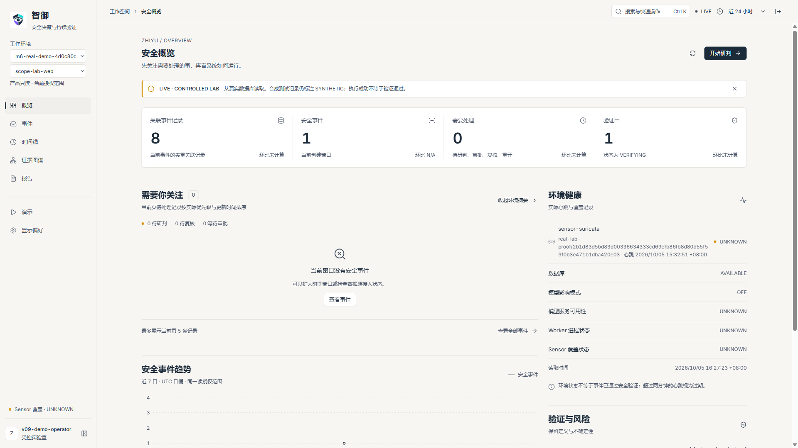

实际 KPI 是以下四项，来自 `/v1/product/overview`，不是计划书中的假设字段。

| 指标 | 读法 |
|---|---|
| 关联事件记录 | 当前可见 Incident 关联的去重 Event 数量，不是全部原始日志量 |
| 安全事件 | 在所选创建时间窗内、当前授权与筛选条件下的 Incident 数量 |
| 需要处理 | NEW / WAITING_APPROVAL / HUMAN_REVIEW / REOPENED 之和 |
| 验证中 | 状态为 VERIFYING 的 Incident 数量；不等于已通过验证 |

环比只对安全事件计算，与前一个同长度窗口比较；前期为零显示 N/A。其他指标明确“环比未计算”。趋势按近七日 UTC 日桶展示，遵守同一读取授权；悬浮查看日期/数量，点击图例隐藏，点击“显示序列”恢复。不要把单一非零日桶误读成完整七天连续观测。

“需要你关注”最多展示当前页五条待处理记录，点击记录或“查看全部事件”研判。“验证与风险”中的综合防护分数为 Not calculated，验证通过率为 N/A；没有正式公式就不生成分数。当前无独立 Protected Assets、Critical Alerts、Decision Loop 或图谱预览组件，不把这些写成已实现功能。

## 7. 查看安全事件

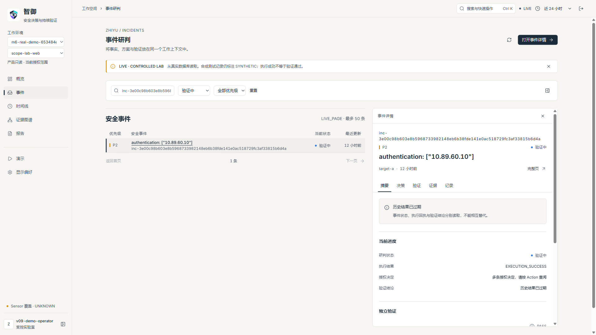

进入“事件”，用 ID/名称搜索，或选择状态、P0–P4 优先级；“重置”恢复筛选。列表按 created_at 窗口查询，显示最近更新相对时间，悬浮可查看完整时间。P0 优先于 P4。状态与优先级是不同信息。

点击一行，在右侧查看详情；“完整页”进入事件详情。详情面板可收起，窄屏以抽屉呈现，关闭后可继续导航。本轮每个 Lab 子环境只有一条 Incident，“下一页/返回首页”禁用；没有造数据来证明列表分页成功。

## 8. Incident Detail

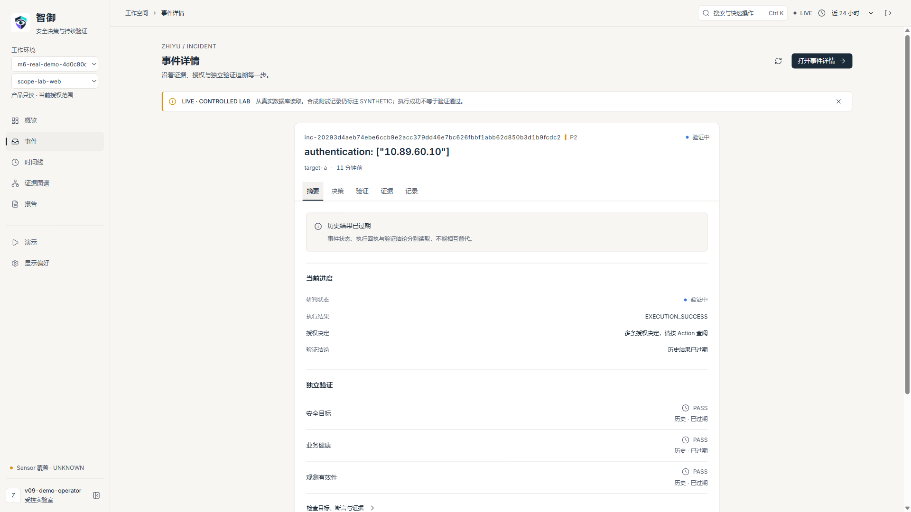

| 页签 | 回答的问题 |
|---|---|
| 摘要 | 当前 Incident 状态、执行回执、授权决定、验证结论分别是什么 |
| 决策 | 输入/模型分析、提案校验、授权/风险/执行记录分别是什么 |
| 验证 | 三维检查、声明、证据、状态更新与有限重规划是什么 |
| 证据 | 证据 ID、来源、hash、时间和信任字段；可转到图谱 |
| 记录 | Raw、Normalization、Event、Group、Correlation、Incident、Audit 沿袭记录 |

卡片的“复制 ID”只复制当前记录 ID。原始日志正文和敏感定位信息不会自动开放。多个授权回执缺少可确定的最新顺序时，摘要会要求按 Action 查阅，不按 ID 大小猜最新记录。Task/Resource 等对象可在时间线、图谱或报告找到；后端对象存在不等于每个详情页签都有专用卡片。

## 9. Timeline

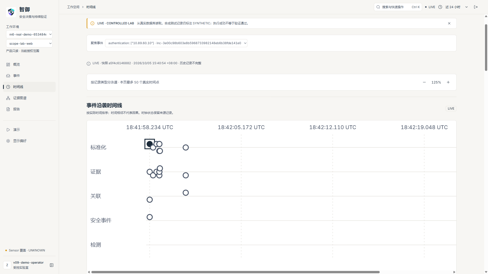

选定“聚焦事件”，按真实时间点和记录类型泳道阅读。时间轴标签为 UTC，列表/卡片完整时间为 UTC+08:00；保留 source_timestamp、observed_at、ingested_at、created_at 等不同语义。来源时间与入库时间不是同一件事。

点击时间点或下方来源记录，查看对应 Fact。可放大/缩小、横向浏览或用“浏览时间轴”定位。来源记录每页最多 50 条，本轮实际翻完三页共 112 点；“返回首页”回第一页。时钟状态、不完整与截断提示必须保留，时间相邻不证明因果。

## 10. Attack / State Graph

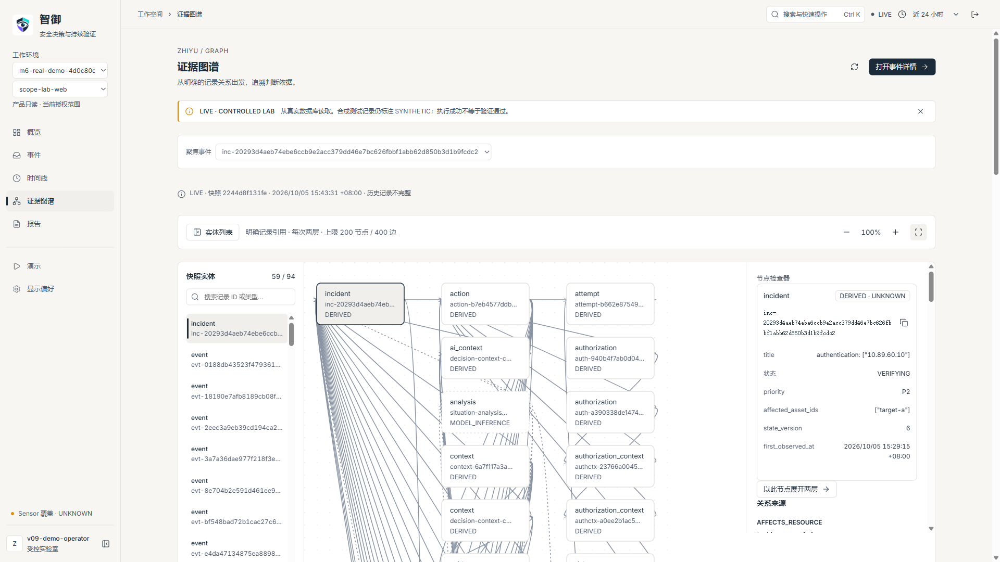

实际页面名为“证据图谱”，展示明确对象引用，不是攻击路径推断。节点表示真实记录；检查器显示类型、字段、basis/freshness。关系来源包含 relation、source_ref、source_field 与 semantic_class，均标明非因果。

从实体列表按 ID/类型搜索，选节点聚焦；点击画布节点检查，再用“以此节点展开两层”。每次两层，上限 200 节点/400 边，未解析引用与截断会提示。“重置图谱视图”返回默认根与缩放。

MODEL_INFERENCE 是模型推断，OBSERVED 是来源观测，DERIVED 是派生关系，UNKNOWN 表示无法确认。图上距离不表示时间或攻击顺序。没有依据的 UNKNOWN 不应被人为美化。

放大后可用鼠标拖动空白处水平平移。本轮两次测试，聚焦画布按右方向键仍未平移（UI-001），尽管标签提示方向键可滚动；未修复。键盘仍可访问实体按钮、节点和缩放按钮，Enter 可检查节点。

## 11. AI Decision

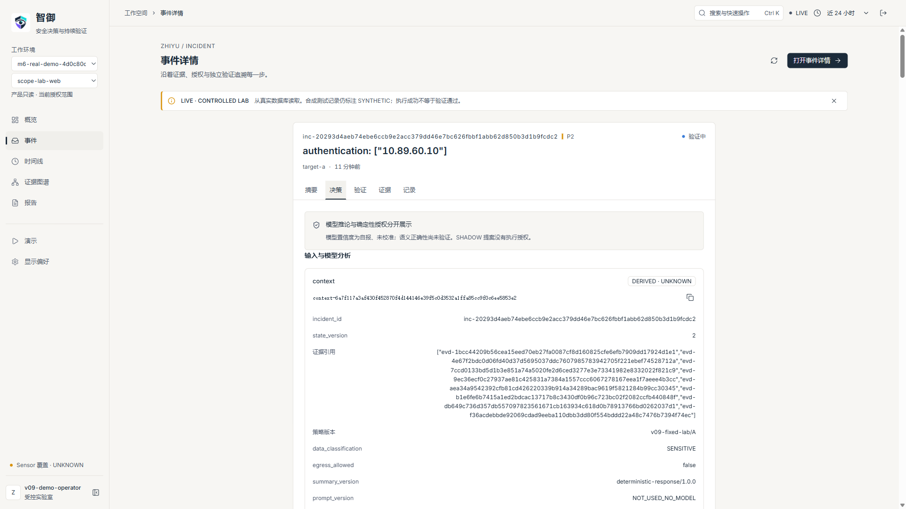

在详情“决策”查 ModelRun 的 model/provider/revision、输入输出 hash、起止时间、latency_ms、schema_valid/safety_status，再查 Analysis/Proposal。此次 A 的本地模型为 zhiyu-qwen2.5-1.5b；provider 字段实际显示 `demo`，模型来源 REAL_LOCAL_MODEL 和权重身份共同说明它是本地运行，不能据字段名推断云供应商。

本轮 A 两次 ModelRun 延迟 45734 / 37396ms。分析为 REFERENCE_GROUNDED，提案为 SHADOW。REFERENCE_GROUNDED 只表示引用约束通过，不表示 AI 保证正确；semantic_correctness 仍为 NOT_VALIDATED。假设中的 model_confidence=0.95 是模型自报且未经校准，不是95%准确率。

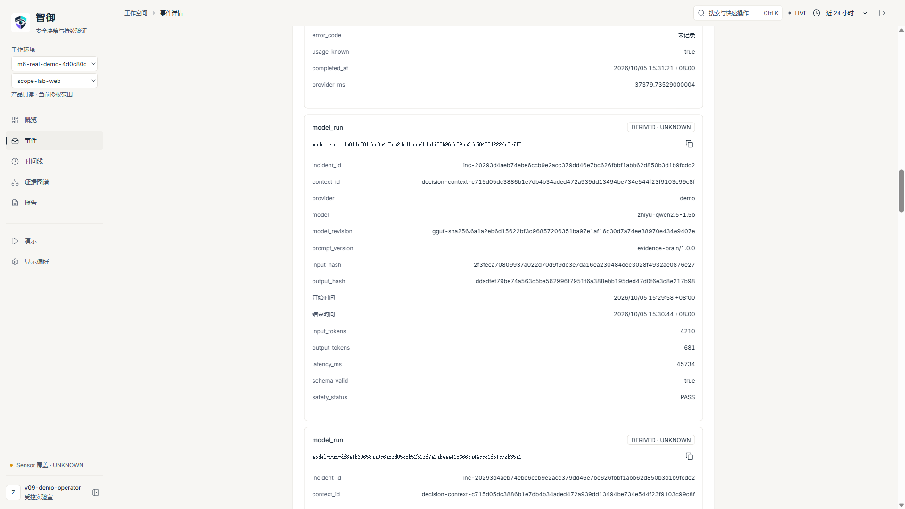

FACT/OBSERVATION 应追到来源记录，INFERENCE 只作为假设。输入引用在上下文/证据记录中核对；不是每个 ID 都是可点击超链接。B 的脚本提案因越界能力被 REJECTED；E 模型不可用产生 FALLBACK，保留确定性方案。B/D 的 SCRIPTED_NOT_AI 不能当作模型能力证明。

## 12. Authorization 与 Risk

“提案”是建议；“授权”是独立确定性决定。按 action_id 对照 AuthorizationContext、Risk 与 Authorization，关注 outcome、assessed_risk、policy_version、valid_until、reasons 和 human_approval_required。A 本轮固定低风险 R2 动作得到 ALLOW；B 在提案校验时就拒绝，没有 Action，不能编造一条 Authorization DENY 回执。

当前没有人工审批、编辑授权、提高风险权限或任意执行的网页。出现“等待审批”状态标签不代表当前实现了审批按钮。历史授权也不授予新的执行权限。

## 13. Action

查看固定 Lab 生成的 Action、Attempt、Result，按 ID 对照执行器、版本、EXECUTION_SUCCESS、output_hash、error_code 与 side_effect。A 的实际执行器为 lab_http_containment，side_effect 为 LAB_PATH：只限制固定一次性实验测试路径，不是宿主机防火墙或真实生产隔离。

浏览器查看这些记录，不手工重发 Action。D 显示执行成功而独立业务检查失败，必须分别阅读。

## 14. Continuous Verification

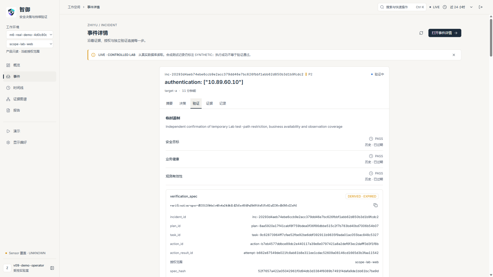

安全目标 Security 检查处置目标是否满足；业务健康 Business 检查业务是否仍可用；观测有效性 Observability 检查证据与 Sensor 覆盖能否支持结论。

| 结果 | 含义 |
|---|---|
| PASS | 指定目标/范围/有效期内检查通过；不意味着永久安全 |
| FAIL | 独立检查实际未满足；不能用执行成功覆盖 |
| INCONCLUSIVE | 证据或观测不足，保持存疑 |

A 本轮三维 PASS；D 安全 PASS/业务 FAIL/观测 PASS；C 三维 INCONCLUSIVE。结果过 valid_until 后显示“历史结果已过期”，历史 PASS 不证明现在健康。A 保留 VERIFYING 与 NO_REPLAN；临时遏制不等于根因修复或自动关单。D 的有限重规划见其 Replan 记录，不另加无关动作。

## 15. Report

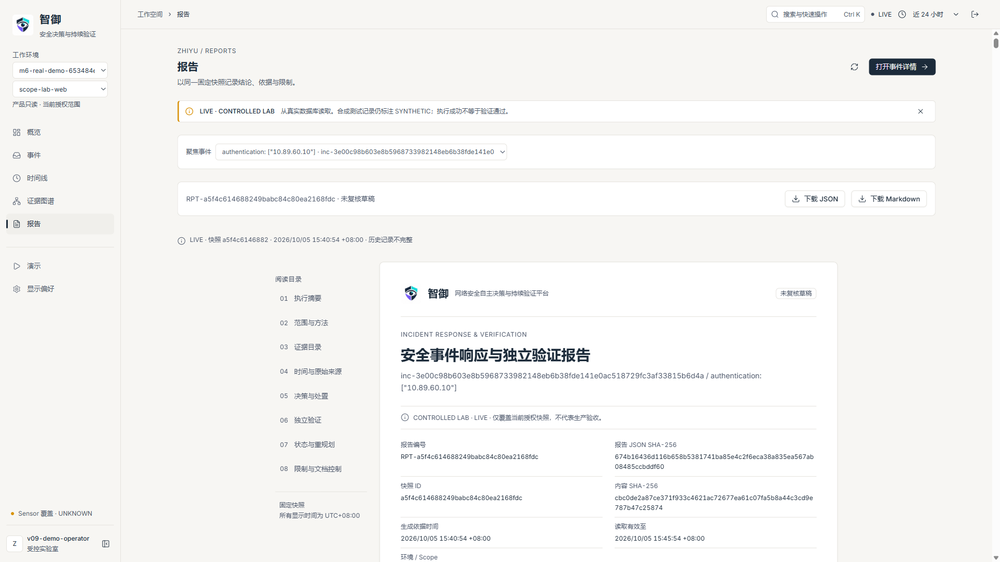

选定事件进入“报告”；系统从同一固定快照构建八节报告：执行摘要、范围与方法、证据目录、事件时间线、决策与处置、独立验证、状态与重规划、限制与文档控制。左侧目录跳到对应章节并聚焦标题。

实际导出只有“下载 JSON”和“下载 Markdown”，没有 HTML/PDF 导出、人工签名或批准发布功能。下载前工作台验证服务端精确字节 SHA256；校验失败不会下载，应重新读取并重试，不能绕过检查。JSON 保留结构化事实，Markdown 便于阅读；两者都要连同限制与来源保存。

区分快照 facts 的 content_sha256、整体报告的 report_sha256、下载文件的 export_sha256。报告状态始终 UNREVIEWED_DRAFT。页脚 0.9.0 是保留的投影/模板协议身份，不表示应用降级；应用版本以 health 1.0.0 为准。

## 16. Demo Mode

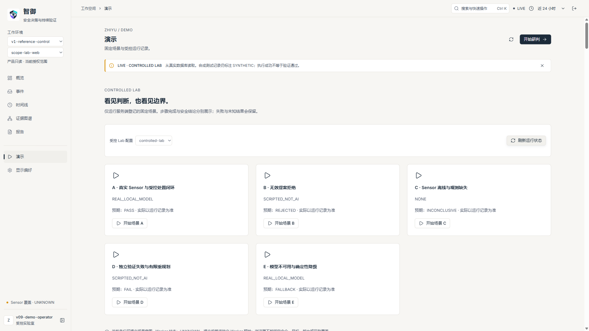

先回 `v1-reference-control`，进入“演示”，选择 `controlled-lab`。管理员保持独立 Worker 运行。点击“开始场景”，再用“刷新运行状态”查看 PREFLIGHT → TRIGGER → VERIFY → ARCHIVE；网页只登记意图，202/QUEUED 不等于已经执行。

| 场景（正式实际名称） | 目的与预期 |
|---|---|
| A 真实 Sensor 与受控处置闭环 | 真实 Sensor + 本地模型 SHADOW + 固定确定性动作 + 独立验证，预期 PASS |
| B 无效提案拒绝 | SCRIPTED_NOT_AI 越界能力反例，预期 REJECTED，Action 数0 |
| C Sensor 离线与观测缺失 | 固定停止一次性 Lab Agent，预期 INCONCLUSIVE |
| D 独立验证失败与有限重规划 | SCRIPTED_NOT_AI 声称成功，但真实业务独立检查 FAIL |
| E 模型不可用与确定性降级 | 固定本地模型停机，预期 FALLBACK，保留确定性计划 |

每个场景都先读“实际/预期”和“模型来源”，再“查看本次事件”。流程 COMPLETED 不等于安全 PASS。终态点击“清理本次资源”，刷新至 CLEAN；然后“重置并新建运行”会创建新 run_id/子环境，原记录、失败、报告保留。本轮 A–E 均分别首次运行和重置再运行，清理结果见走查表。

“停止后续步骤”只阻止后续调度，不撤销已执行动作。未确定步骤或租约丢失出现 NEEDS_RECONCILIATION，交管理员核对，不连续重发。一次同 profile 只允许一个未清理运行。

## 17. LIVE 与 REPLAY

LIVE 表示从当前数据库读取，历史事实可能过期，来源仍可能 SYNTHETIC。RECORDED_REPLAY 是登记档案的历史封存读取，保留原 as_of、facts、结果、hash；不表示实时 Sensor 正常，也不调用模型、不产生 Action 或验证写入。

在已完成运行点“历史回放”，或在相应子环境的“封存记录回放”点“打开历史回放”。顶部、范围条与快照提示显示回放标识，时间窗禁用。时间线、图谱、决策/验证和报告共用同一封存事实。刷新回放仍读取档案，不把失败换成成功。

回放列表入口只是阅读。回登记控制环境主动点“开始场景”仍会提交一个独立 LIVE 运行意图；不要把整个演示页面理解成永远无写入按钮。本轮回放无副作用结论来自没有点这些 LIVE 按钮的只读路径，以及全部74表前后摘要比较。

## 18. System Status

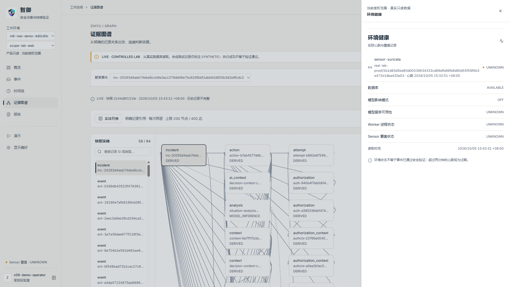

Sensor 行显示实际配置版本、最近心跳与有效状态。心跳超过两分钟为过期 UNKNOWN；无完整覆盖或未验证覆盖也为 UNKNOWN。HEALTHY/DEGRADED 是当前观测条件的汇总，不是 Incident 验证结果。

数据库 AVAILABLE 是当前查询成功。模型影响模式 OFF 是环境策略；模型服务可用性和 Worker 进程状态当前实现保留 UNKNOWN，不能由此断言进程在线或离线。A 场景临时启用 SHADOW 与环境全局 OFF 是不同层次。

Backend/API 看管理员的 health/ready；Frontend 通过实际页面加载判断。本面板没有独立 Frontend、API 探针行。不能把不存在的组件健康监控写成现成功能。

## 19. 常见状态解释

| 状态 | 用户应如何理解 |
|---|---|
| Healthy / HEALTHY | 当前有效覆盖检查正常；不等于永久安全 |
| Degraded / DEGRADED | 有已记录退化，仍须看具体 Sensor/检查 |
| Unavailable / OFFLINE | 服务/来源不可用，不推定安全 |
| Unknown / UNKNOWN | 没有足够当前有效信息，不能当成正常 |
| Open | 本工作台不是实际状态枚举；新事件显示 NEW“待研判” |
| Investigating / INVESTIGATING | 调查中 |
| Contained / CONTAINED | 已遏制；未必修复根因 |
| VERIFYING | 验证中；即使有短期 PASS 也可能保留此状态 |
| PASS / FAIL / INCONCLUSIVE | 指定范围内通过/失败/无法确认 |
| SHADOW | 影子建议，无执行授权 |
| REJECTED | 提案未通过校验，查看 validation.reasons |
| FALLBACK | 模型不可用或未接受，使用确定性基线 |
| CLEAN | 本次一次性 Lab 资源已清理，历史记录仍在 |

## 20. 常见故障

| 现象 | 已验证的操作或明确限制 |
|---|---|
| Web Console 打不开 | 先确认本机URL/端口与 Docker Linux Engine；管理员查 health/ready。START-001 的底层停止情形须核验本部署归属再处理，不能靠删库重装 |
| Backend unavailable | 本轮实际停止 API 后观察到读取失败，按正式 start 启动、ready通过、重新登录后恢复；禁止从旧截图判断恢复 |
| Database unavailable | 浏览器503错误显示/撤旧指标已测试；本轮未主动破坏数据库或证明任意DB故障修复。交管理员按排障/备份恢复指南处理 |
| Sensor offline | C 真实场景保留 UNKNOWN/INCONCLUSIVE；终态清理，再新建已登记运行可重新建立受控 Sensor。历史错误不改为成功 |
| Model offline | E 真实场景保留 FALLBACK；可展示确定性链或明确切历史回放，不能提高权限弥补模型故障 |
| No incidents | 确认当前环境/Scope，重置筛选，再选168小时。没有就展示空态，不造数据 |
| Report failed | 本轮篡改浏览器响应 hash 的注入被拒且无下载，恢复正常响应后正常导出成功；重新读取/重试，不绕过hash |
| Replay failed | 确认是已登记、有权读取的档案，重新读取；未授权/缺失/损坏档案不能用上传或任意路径替换。任意损坏档案修复本轮未实测 |
| 401 / 403 / 410 / 429 | 分别重新登录、选择获准范围、显式刷新快照、稍后刷新。快速筛选可能429，读取限制不放宽 |

通用数据库灾难、任意模型修复、镜像升级、公网问题不在此手册的已验证恢复承诺内。详见 [排障指南](TROUBLESHOOTING_GUIDE.md)。

## 21. 安全限制

只操作登记 CONTROLLED LAB 目标/能力/场景。AI默认OFF，启用默认SHADOW；高风险自主动作0。Proposal不等于Authorization，执行成功不等于安全成功，缺观测不判PASS。Production NOT VALIDATED；不能接任意恶意流量、陌生Lab peer或公开服务后沿用当前结论。

冻结第三方镜像仍保留520个 Critical/High 告警出现项的受控运行剩余风险；这不是零漏洞产品。[安全基线](SECURITY_BASELINE_v1.0.md) 与 [最终限制](KNOWN_LIMITATIONS.md) 共同约束演示。

## 22. 正确关闭系统

回登记控制环境查看运行记录。等所有本次运行终态，逐项申请清理并刷新至 CLEAN。未知或 NEEDS_RECONCILIATION 先交管理员核对，不能把“停止后续步骤”当回滚。

所有运行 CLEAN 后，在独立 Worker 终端按 Ctrl+C 退出；再在工程根目录执行：

```powershell
& $runtime tools/release_profile.py stop --deployment $deployment
```

该正式 stop **只停止 Web API**，保留 PostgreSQL、ingress 和证据，不是全 Docker/WSL 关机。Lab 必须先清理。本轮已实际验证此关闭和再启动路径。不要执行 down -v、删除 volume 或关闭其他项目。API重启会丢失浏览器会话/内存快照，需重新登录；登记录制仍可回放。

## 23. 数据备份与恢复入口

普通用户保存获准 JSON/Markdown 报告；数据库备份/新空环境恢复是管理员功能，没有浏览器备份按钮。管理员进入 [ADMIN_GUIDE](ADMIN_GUIDE.md)、[备份恢复](BACKUP_RESTORE_GUIDE.md)、[升级指南](UPGRADE_GUIDE.md)。备份含凭据，必须私密保存，不能当作公开演示包；模型权重、镜像和运行依赖不包含在逻辑备份内。

## 24. 已知限制

以最终 [KNOWN_LIMITATIONS](KNOWN_LIMITATIONS.md) 为准：仅稳定原型/CONTROLLED LAB；生产、客户部署、长期SLA、Cloud/Windows Sensor/OT/ICS、公网TLS未验证；HA/多租户未实现；通用AI语义正确性未证明，闭环优越性不主张，G0不包含。报告未复核、未人工签名，时间线/图谱不证明攻击因果。

本轮附加走查没有修复 START-001、UI-001 或旧指南状态表述，没有改变原PASS文件或ZIP。负责人应结合 [功能清单](FINAL_FUNCTION_INVENTORY_v1.0.0.md) 与 [走查发现](FULL_PRODUCT_WALKTHROUGH_v1.0.0.md) 决定后续处置；本轮到文档交付为止。
